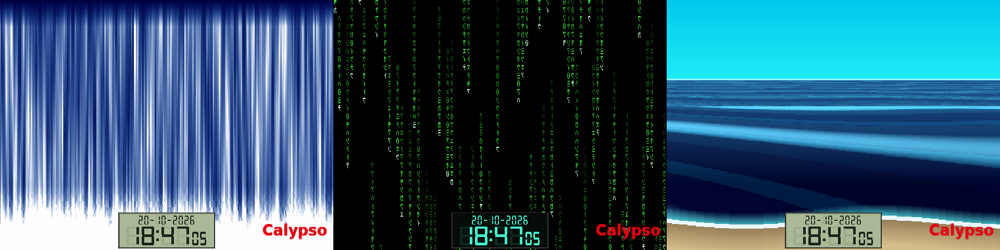
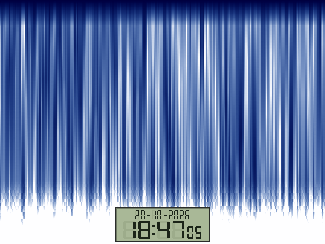
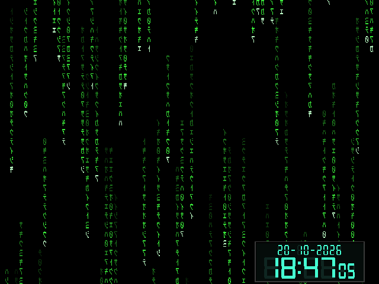
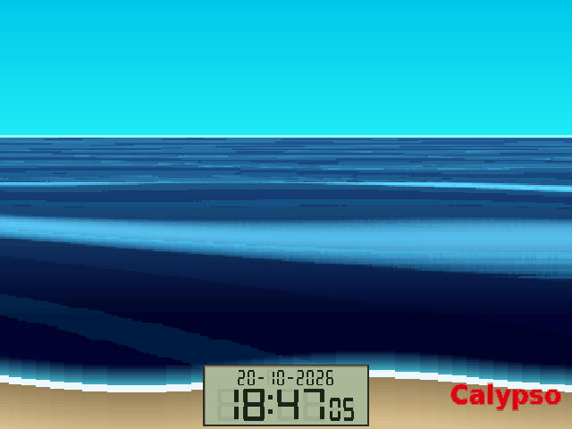
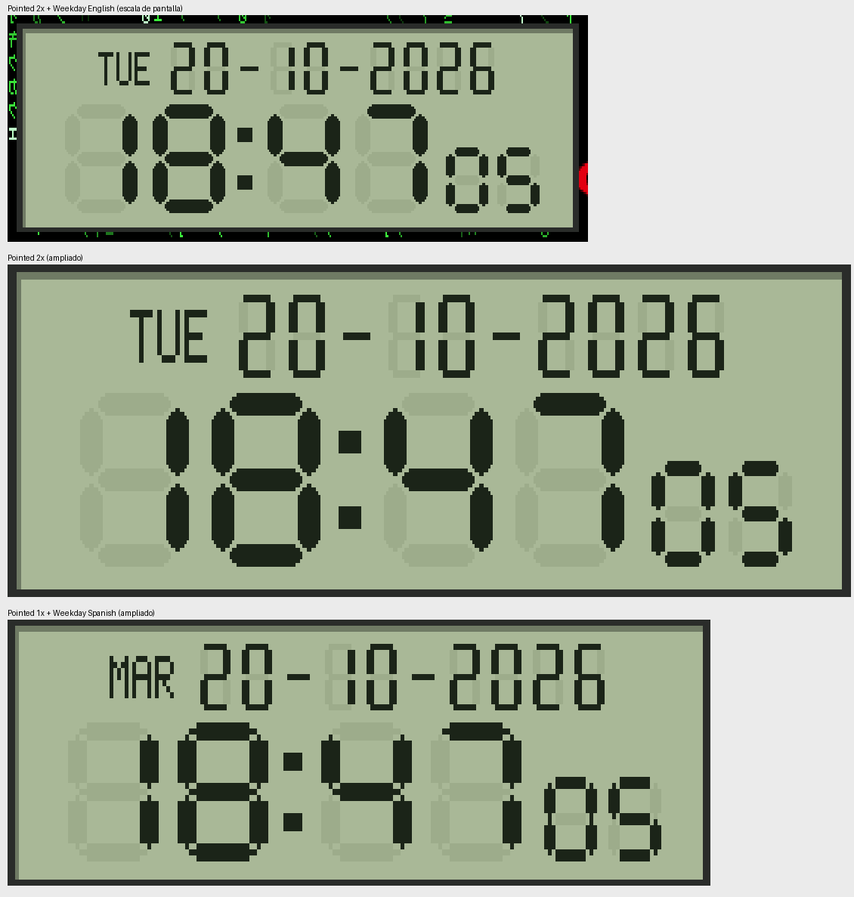
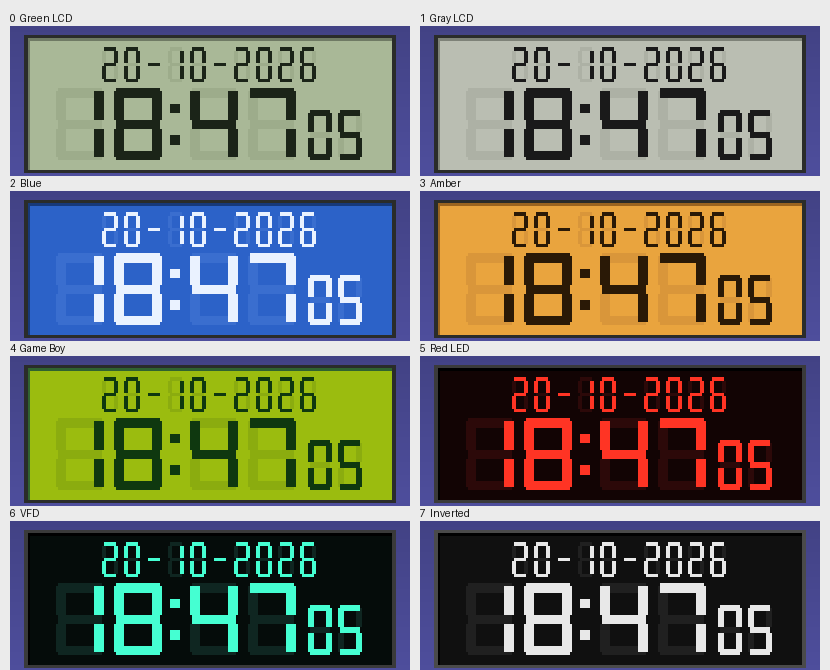
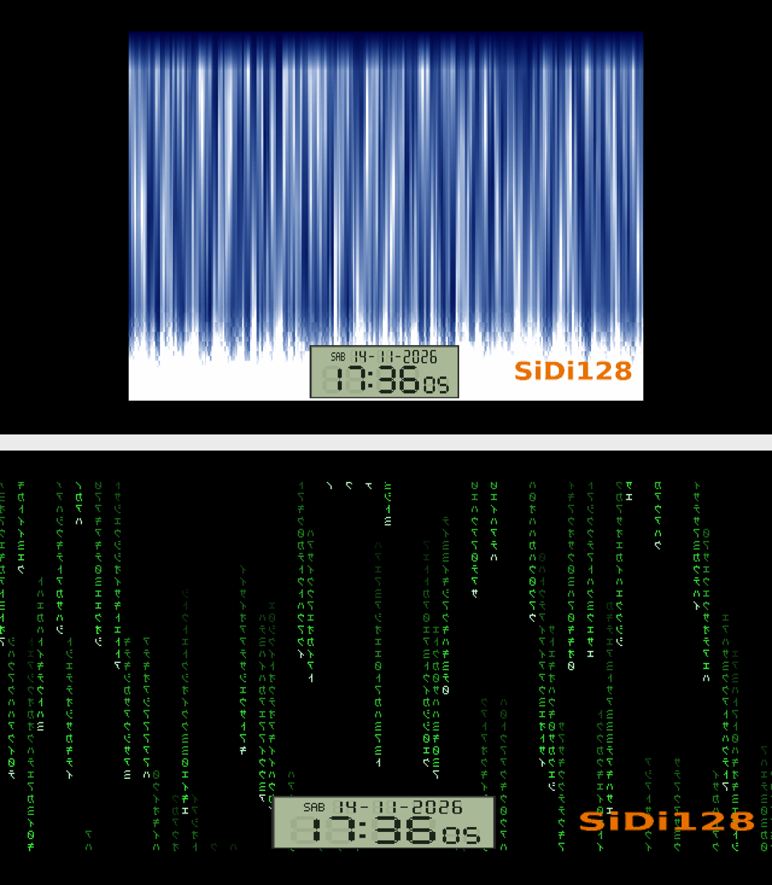
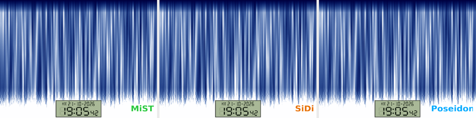

# CoreMenuFpga

*[Leer en español](README_es.md)*

The **menu core** (the core that is loaded when the board starts) for the
MiST-family FPGA boards: **MiST**, **SiDi**, **SiDi128**, **Calypso** and
**Poseidon**. It is based on the Calypso menu core and adds animated
backgrounds, an LCD style clock for a USB RTC, the board logo and, on the
SiDi128, a standard 1080p HDMI output.

The core keeps the internal name `MENU`, so the firmware handles it as the
menu core on every board.



## Features

- **Animated backgrounds**: waterfall, Matrix style "digital rain" and a sea
  with waves and a shore, plus the classic background and the picture from
  `MENU.ROM`. Adjustable animation speed.
- **LCD clock** when a USB RTC is connected: date, weekday and time, with
  two sizes, flat or pointed segments, three date formats, nine positions and
  eight color schemes.
- **Board logo** in a corner of the background (Calypso, MiST, SiDi,
  SiDi128 or Poseidon).
- **SiDi128: HDMI at 1080p60** (CEA-861, VIC 16) with integer scaling, so it
  works on any TV or monitor, at the same time as the VGA output.
- KITT mode with sound, as in the original menu core.

## Installation

Download the `.rbf` of your board from the
[Releases](../../releases) page, rename it and copy it to the root of the SD
card:

| Board    | File in the release            | Name on the SD |
|----------|--------------------------------|----------------|
| MiST     | `CoreMenuFpga_MiST_*.rbf`      | `core.rbf`     |
| SiDi     | `CoreMenuFpga_SiDi_*.rbf`      | `core.rbf`     |
| SiDi128  | `CoreMenuFpga_SiDi128_*.rbf`   | `sidi128.rbf`  |
| Calypso  | `CoreMenuFpga_Calypso_*.rbf`   | `CORE.RBF`     |
| Poseidon | `CoreMenuFpga_Poseidon_*.rbf`  | `core.rbf`     |

Keep a copy of your previous menu core in case you want to go back.

A BMP of 640x312 pixels and 32 bit color can be used as background picture:
copy it as `MENU.ROM` to the root of the SD card and choose
**Background > Type > File**.

## OSD options

| Option | Values |
|---|---|
| Video mode | PAL, NTSC |
| Rotate | Off, Left, Right |
| KITT Mode | Off, On |
| HDMI 1080p (SiDi128) | 4:3, Wide |
| OSD HPos / VPos / Color | position and color of the OSD |
| **Background** submenu | Type, Speed, Logo |
| **Clock** submenu | Clock, Size, Segments, Panel, Shadow, Vertical, Horizontal, Date, Weekday, Color |

### Background

- **Type**: Waterfall (default), Matrix, Sea, Classic or File (the
  `MENU.ROM` picture or a BMP loaded with *Change background*; Classic if
  there is none).
- **Speed**: Normal, Slow, Very slow or Fast.
- **Logo**: On / Off. The board logo is drawn in the bottom right corner of
  every background except File.

| Waterfall | Matrix | Sea |
|---|---|---|
|  |  |  |

### LCD clock

When the firmware sends the time from a USB RTC, the menu shows a clock with
the date in small digits and the time in big digits. It only appears while
the RTC is present.

- **Clock**: On / Off.
- **Size**: 1x (default) or 2x.
- **Segments**: Flat (default) or Pointed (hexagonal segments with "<=>"
  ends, as in big LED clocks).
- **Panel**: On / Off (only the digits, over the background).
- **Shadow**: On / Off (the unlit segments).
- **Vertical**: Bottom, Top or Center. **Horizontal**: Center, Left or Right.
- **Date**: DD-MM-YYYY, MM-DD-YYYY or YYYY-MM-DD.
- **Weekday**: Off, English (MON) or Spanish (LUN).
- **Color**: Green LCD, Gray LCD, Blue, Amber, Game Boy, Red LED, VFD or
  Inverted.




A USB RTC that works with the MiST firmware can be built with a Raspberry Pi
Pico: see [rtc-usb-mist-rp2040](https://github.com/shaeon/rtc-usb-mist-rp2040).
On the Calypso it needs a firmware with USB RTC support.

## SiDi128: HDMI output

The SiDi128 has VGA and HDMI (IT6613 transmitter). The HDMI output is made
to work on any TV or monitor:

- Fixed **1920x1080p60** timing (CEA-861 VIC 16, 148.5 MHz, 2200x1125),
  independent of the VGA output and of the PAL/NTSC option. Its sync never
  stops (resets, downloads...).
- The core tells the firmware that its pixel clock is above 80 MHz, so the
  firmware announces VIC 16 in the AVI InfoFrame and sets the transmitter for
  a high clock: what the TV is told matches what it gets.
- Integer scaling, every pixel the same size: **4:3** (default) gives
  1280x936 centered (x2, x3), **Wide** gives 1920x936 (x3, x3).
- The picture is drawn a second time, with the OSD, by a renderer locked to
  the HDMI timing, into a two-line buffer: no frame buffer and about one line
  of latency.
- Sound through I2S, HDMI (48 kHz) and the analog outputs.



## Boards

| Board    | FPGA                     | Clock | Video          | Sound              |
|----------|--------------------------|-------|----------------|--------------------|
| MiST     | Cyclone III EP3C25       | 27 MHz | VGA 6 bit     | sigma-delta        |
| SiDi     | Cyclone IV E EP4CE22     | 27 MHz | VGA 6 bit     | sigma-delta        |
| SiDi128  | Cyclone 10 LP 10CL120    | 50 + 27 MHz | VGA 8 bit + HDMI 1080p | I2S, HDMI, sigma-delta |
| Calypso  | Cyclone 10 LP 10CL025    | 12 MHz | VGA           | I2S (+ MIDI player) |
| Poseidon | Cyclone IV GX EP4CGX150  | 50 MHz | VGA 6 bit     | I2S                |

- MiST, SiDi, SiDi128 and Poseidon share the top (`rtl/menu_top.sv`). The
  Calypso keeps its own top from calypso-ports, with the MIDI player.
- MiST, SiDi and Poseidon keep the `MENU.ROM` picture in SDRAM (Poseidon with
  the SDRAM clock inverted through a DDR register). The SiDi128 keeps it in
  block RAM, so both outputs can read it.



## Building

Every push builds all the boards with GitHub Actions
(`.github/workflows/build.yml`); the `.rbf` files are in the run's
artifacts, and a `v*` tag creates a release with all of them.

To build locally, open the project of the board in Quartus and compile:

| Board    | Project                         | Quartus      |
|----------|---------------------------------|--------------|
| MiST     | `mist/menu_mist.qpf`            | 13.1         |
| SiDi     | `sidi/menu_sidi.qpf`            | 17.0 or later |
| SiDi128  | `sidi128/menu_sidi128.qpf`      | 17.0 or later |
| Calypso  | `calypso/menu_calypso.qpf`      | 17.0 or later |
| Poseidon | `poseidon/menu_poseidon.qpf`    | 17.0 or later |

The `.rbf` goes to `output_files/` in the board folder.

```
core.definition, files.qip   common to all boards
rtl/                         backgrounds, clock, logo mixing (menu_render.sv),
                             common top (menu_top.sv), SDRAM controller,
                             SiDi128 HDMI output and picture in block RAM
common/mist-modules/         MiST modules (user_io, data_io, mist_video, OSD...)
tools/gen_logo.py            generates a board_logo.sv from a text
calypso/ mist/ sidi/         one folder per board: project, pins, PLL, logo
sidi128/ poseidon/
docs/images/                 screenshots (simulated)
```

To change a logo: `python3 tools/gen_logo.py TEXT R G B mist/board_logo.sv`.

## Credits

This core stands on the work of many people. Thank you all.

- **Menu core**: the MiST project (Menu_MIST), and its Calypso version with
  the MIDI player by Manuel Teira (**teiram**)
  (https://github.com/teiram/calypso-ports).
- **MiST modules** (`user_io`, `data_io`, `mist_video`, OSD, scandoubler,
  `i2s`, `i2c_master` and related): Till Harbaum, Gyorgy Szombathelyi
  (gyurco), Sorgelig and the MiST/MiSTer community. GPL v3 or later.
- **SDRAM controller**: Till Harbaum and Gyorgy Szombathelyi. GPL v3 or later.
- Delta-sigma DAC: based on Xilinx application note XAPP154.
- Animated backgrounds, LCD clock, MiST, SiDi, SiDi128 and Poseidon ports and
  the SiDi128 HDMI output: Shaeon (Carlos Palmero).

## Thanks

To the **Retro-Wiki FPGA-dev Team**, especially **Ron, Manuel (teiram), Somhi,
Roderick, Rampa, Kyp and Benito**, for their help and patience.

## AI assistance and resources

Parts of this core were developed with the assistance of Claude (Anthropic),
used for code, testbenches, simulations, screenshots and documentation.
Access to Claude was provided by Advanced Computer Trading, S.L. (actsl.com),
which also authorises the publication of this work under the license below.
All design decisions, integration, testing on real hardware and final review
were carried out by the author, Shaeon (Carlos Palmero).

## License

Copyright (C) 2026 Shaeon (Carlos Palmero).

This program is free software: you can redistribute it and/or modify it
under the terms of the **GNU General Public License** as published by the
Free Software Foundation, either **version 3** of the License, or (at your
option) any later version. See [LICENSE](LICENSE).

Version 3 is required because some of the included modules (the MiST
modules and the SDRAM controller) are licensed under GPL v3 or later.
Third-party files keep their own copyright notices and licenses, which are
compatible with the GPL v3.

## Disclaimer

This project is provided **"as is", without warranty of any kind**, express
or implied, including but not limited to the warranties of merchantability
and fitness for a particular purpose. In no event shall the authors or
contributors be liable for any claim, damages or other liability arising
from the use of this software, of the hardware it runs on, or of any
connected equipment. Use it at your own risk.

MiST, SiDi, Calypso and Poseidon are names of their respective owners. This
project is not affiliated with or endorsed by them.
