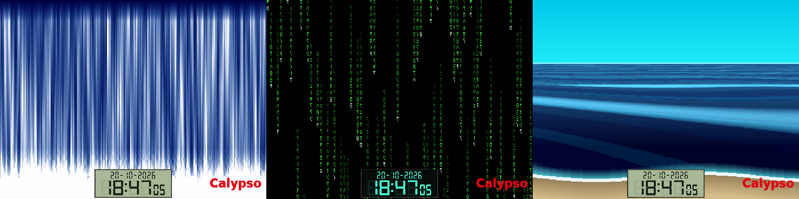
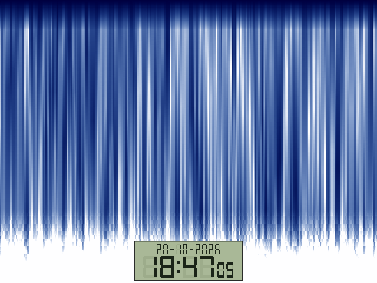
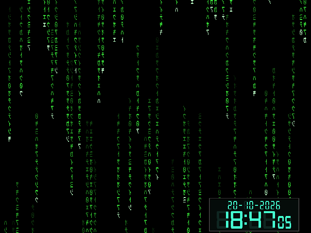
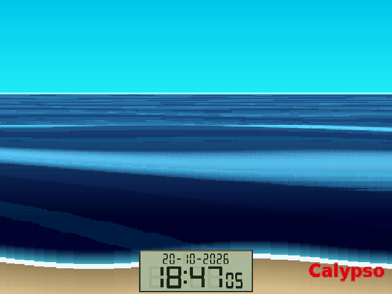
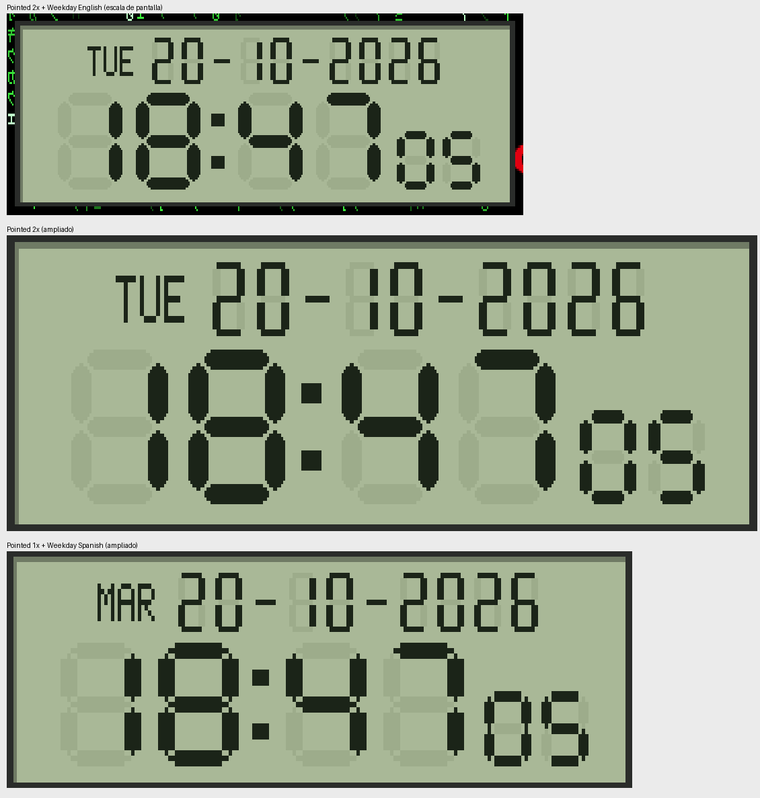
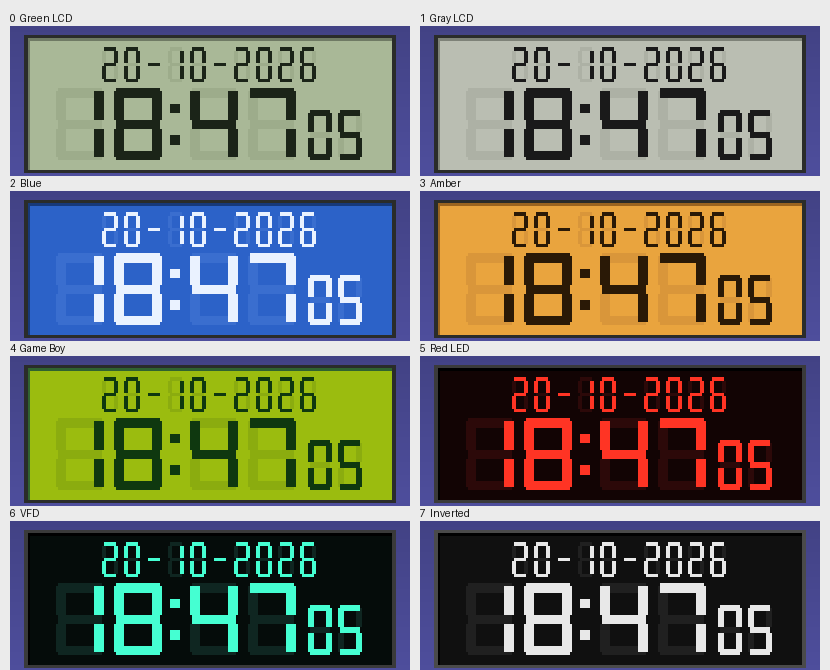
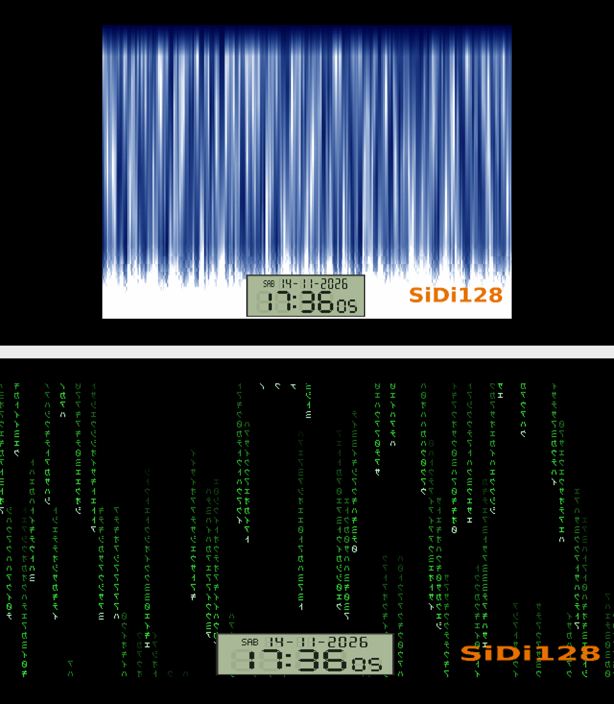
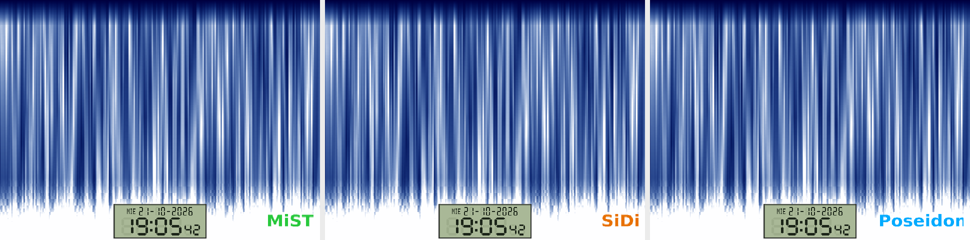

# CoreMenuFpga

*[Read in English](README.md)*

El **core de menú** (el core que se carga al encender la placa) para las
placas FPGA de la familia MiST: **MiST**, **SiDi**, **SiDi128**, **Calypso** y
**Poseidon**. Parte del core de menú de la Calypso y añade fondos animados, un
reloj de estilo LCD para un RTC USB, el logo de la placa y, en la SiDi128, una
salida HDMI estándar a 1080p.

El core mantiene el nombre interno `MENU`, así que el firmware lo trata como
core de menú en todas las placas.



## Características

- **Fondos animados**: catarata, "lluvia digital" al estilo Matrix y un mar
  con olas y orilla, además del fondo clásico y la imagen de `MENU.ROM`.
  Velocidad de animación ajustable.
- **Reloj LCD** cuando hay un RTC USB conectado: fecha, día de la semana y
  hora, con dos tamaños, segmentos planos o en flecha, tres formatos de fecha,
  nueve posiciones y ocho esquemas de color.
- **Logo de la placa** en una esquina del fondo (Calypso, MiST, SiDi, SiDi128
  o Poseidon).
- **SiDi128: HDMI a 1080p60** (CEA-861, VIC 16) con escalado entero, para que
  funcione en cualquier televisor o monitor, a la vez que la salida VGA.
- Modo KITT con sonido, como en el core de menú original.

## Instalación

Descarga el `.rbf` de tu placa de la página de
[Releases](../../releases), cámbiale el nombre y cópialo a la raíz de la
tarjeta SD:

| Placa    | Fichero de la release          | Nombre en la SD |
|----------|--------------------------------|-----------------|
| MiST     | `CoreMenuFpga_MiST_*.rbf`      | `core.rbf`      |
| SiDi     | `CoreMenuFpga_SiDi_*.rbf`      | `core.rbf`      |
| SiDi128  | `CoreMenuFpga_SiDi128_*.rbf`   | `sidi128.rbf`   |
| Calypso  | `CoreMenuFpga_Calypso_*.rbf`   | `CORE.RBF`      |
| Poseidon | `CoreMenuFpga_Poseidon_*.rbf`  | `core.rbf`      |

Guarda una copia del core de menú que tenías por si quieres volver a él.

Como imagen de fondo se puede usar un BMP de 640x312 píxeles y 32 bits de
color: cópialo como `MENU.ROM` a la raíz de la SD y elige
**Background > Type > File**.

## Opciones del OSD

| Opción | Valores |
|---|---|
| Video mode | PAL, NTSC |
| Rotate | Off, Left, Right |
| KITT Mode | Off, On |
| HDMI 1080p (SiDi128) | 4:3, Wide |
| OSD HPos / VPos / Color | posición y color del OSD |
| Submenú **Background** | Type, Speed, Logo |
| Submenú **Clock** | Clock, Size, Segments, Panel, Shadow, Vertical, Horizontal, Date, Weekday, Color |

### Fondo (Background)

- **Type**: Waterfall (por defecto), Matrix, Sea, Classic o File (la imagen
  `MENU.ROM` o un BMP cargado con *Change background*; si no hay ninguno, el
  clásico).
- **Speed**: Normal, Slow, Very slow o Fast.
- **Logo**: On / Off. El logo de la placa se dibuja en la esquina inferior
  derecha de todos los fondos menos File.

| Waterfall | Matrix | Sea |
|---|---|---|
|  |  |  |

### Reloj LCD (Clock)

Cuando el firmware envía la hora de un RTC USB, el menú muestra un reloj con
la fecha en dígitos pequeños y la hora en dígitos grandes. Solo aparece
mientras el RTC está conectado.

- **Clock**: On / Off.
- **Size**: 1x (por defecto) o 2x.
- **Segments**: Flat (por defecto) o Pointed (segmentos hexagonales con
  puntas "<=>", como los relojes grandes de LED).
- **Panel**: On / Off (solo los dígitos, sobre el fondo).
- **Shadow**: On / Off (los segmentos apagados).
- **Vertical**: Bottom, Top o Center. **Horizontal**: Center, Left o Right.
- **Date**: DD-MM-YYYY, MM-DD-YYYY o YYYY-MM-DD.
- **Weekday**: Off, English (MON) o Spanish (LUN).
- **Color**: Green LCD, Gray LCD, Blue, Amber, Game Boy, Red LED, VFD o
  Inverted.




Un RTC USB compatible con el firmware de MiST se puede hacer con una
Raspberry Pi Pico: mira
[rtc-usb-mist-rp2040](https://github.com/shaeon/rtc-usb-mist-rp2040). En la
Calypso hace falta un firmware con soporte de RTC USB.

## SiDi128: salida HDMI

La SiDi128 tiene VGA y HDMI (transmisor IT6613). La salida HDMI está hecha
para que funcione en cualquier televisor o monitor:

- Temporización fija **1920x1080p60** (CEA-861 VIC 16, 148,5 MHz,
  2200x1125), independiente de la salida VGA y de la opción PAL/NTSC. La
  sincronía no se corta nunca (resets, cargas...).
- El core le indica al firmware que su reloj de píxel pasa de 80 MHz, así que
  el firmware anuncia VIC 16 en el AVI InfoFrame y configura el transmisor
  para un reloj alto: lo que se le dice al televisor coincide con lo que
  recibe.
- Escalado entero, todos los píxeles del mismo tamaño: **4:3** (por defecto)
  da 1280x936 centrado (x2, x3) y **Wide** da 1920x936 (x3, x3).
- La imagen se dibuja una segunda vez, con el OSD, con un renderizador
  sincronizado con el HDMI, en un buffer de dos líneas: sin frame buffer y con
  una latencia de una línea.
- Sonido por I2S, HDMI (48 kHz) y las salidas analógicas.



## Placas

| Placa    | FPGA                     | Reloj | Vídeo          | Sonido             |
|----------|--------------------------|-------|----------------|--------------------|
| MiST     | Cyclone III EP3C25       | 27 MHz | VGA 6 bits    | sigma-delta        |
| SiDi     | Cyclone IV E EP4CE22     | 27 MHz | VGA 6 bits    | sigma-delta        |
| SiDi128  | Cyclone 10 LP 10CL120    | 50 + 27 MHz | VGA 8 bits + HDMI 1080p | I2S, HDMI, sigma-delta |
| Calypso  | Cyclone 10 LP 10CL025    | 12 MHz | VGA           | I2S (+ reproductor MIDI) |
| Poseidon | Cyclone IV GX EP4CGX150  | 50 MHz | VGA 6 bits    | I2S                |

- MiST, SiDi, SiDi128 y Poseidon comparten el top (`rtl/menu_top.sv`). La
  Calypso mantiene su propio top de calypso-ports, con el reproductor MIDI.
- MiST, SiDi y Poseidon guardan la imagen de `MENU.ROM` en la SDRAM (la
  Poseidon con el reloj de la SDRAM invertido por un registro DDR). La SiDi128
  la guarda en BRAM para que puedan leerla las dos salidas.



## Compilar

Con cada push, GitHub Actions compila todas las placas
(`.github/workflows/build.yml`); los `.rbf` quedan en los artefactos de la
ejecución, y una etiqueta `v*` crea una release con todos ellos.

Para compilar en local, abre el proyecto de la placa en Quartus y compila:

| Placa    | Proyecto                        | Quartus        |
|----------|---------------------------------|----------------|
| MiST     | `mist/menu_mist.qpf`            | 13.1           |
| SiDi     | `sidi/menu_sidi.qpf`            | 17.0 o posterior |
| SiDi128  | `sidi128/menu_sidi128.qpf`      | 17.0 o posterior |
| Calypso  | `calypso/menu_calypso.qpf`      | 17.0 o posterior |
| Poseidon | `poseidon/menu_poseidon.qpf`    | 17.0 o posterior |

El `.rbf` sale en `output_files/` dentro de la carpeta de la placa.

```
core.definition, files.qip   comunes a todas las placas
rtl/                         fondos, reloj, mezcla del logo (menu_render.sv),
                             top común (menu_top.sv), controlador de SDRAM,
                             salida HDMI de la SiDi128 e imagen en BRAM
common/mist-modules/         módulos de MiST (user_io, data_io, mist_video, OSD...)
tools/gen_logo.py            genera un board_logo.sv a partir de un texto
calypso/ mist/ sidi/         una carpeta por placa: proyecto, pines, PLL, logo
sidi128/ poseidon/
docs/images/                 capturas (simuladas)
```

Para cambiar un logo: `python3 tools/gen_logo.py TEXTO R G B mist/board_logo.sv`.

## Créditos

Este core se apoya en el trabajo de mucha gente. Gracias a todos.

- **Core de menú**: el proyecto MiST (Menu_MIST), y su versión para Calypso
  con el reproductor MIDI, de Manuel Teira (**teiram**)
  (https://github.com/teiram/calypso-ports).
- **Módulos de MiST** (`user_io`, `data_io`, `mist_video`, OSD, scandoubler,
  `i2s`, `i2c_master` y relacionados): Till Harbaum, Gyorgy Szombathelyi
  (gyurco), Sorgelig y la comunidad MiST/MiSTer. GPL v3 o posterior.
- **Controlador de SDRAM**: Till Harbaum y Gyorgy Szombathelyi. GPL v3 o
  posterior.
- DAC delta-sigma: basado en la nota de aplicación XAPP154 de Xilinx.
- Fondos animados, reloj LCD, ports a MiST, SiDi, SiDi128 y Poseidon y la
  salida HDMI de la SiDi128: Shaeon (Carlos Palmero).

## Agradecimientos

Al **Retro-Wiki FPGA-dev Team**, en especial a **Ron, Manuel (teiram), Somhi,
Roderick, Rampa, Kyp y Benito**, por su ayuda y su paciencia.

## Asistencia de IA y recursos

Partes de este core se desarrollaron con la ayuda de Claude (Anthropic), usado
para código, bancos de pruebas, simulaciones, capturas y documentación. El
acceso a Claude lo proporcionó Advanced Computer Trading, S.L. (actsl.com),
que además autoriza la publicación de este trabajo bajo la licencia indicada
abajo. Todas las decisiones de diseño, la integración, las pruebas en hardware
real y la revisión final las hizo el autor, Shaeon (Carlos Palmero).

## Licencia

Copyright (C) 2026 Shaeon (Carlos Palmero).

Este programa es software libre: puedes redistribuirlo y/o modificarlo bajo
los términos de la **Licencia Pública General de GNU** publicada por la Free
Software Foundation, ya sea la **versión 3** de la licencia o (a tu elección)
cualquier versión posterior. Ver [LICENSE](LICENSE).

Hace falta la versión 3 porque algunos de los módulos incluidos (los de MiST
y el controlador de SDRAM) tienen licencia GPL v3 o posterior. Los ficheros de
terceros conservan sus propios avisos de copyright y licencias, que son
compatibles con la GPL v3.

## Exención de responsabilidad

Este proyecto se entrega **"tal cual", sin garantía de ningún tipo**, ni
expresa ni implícita, incluidas, entre otras, las garantías de
comerciabilidad y de idoneidad para un fin concreto. En ningún caso los
autores o colaboradores serán responsables de ninguna reclamación, daño u otra
responsabilidad derivada del uso de este software, del hardware en el que se
ejecuta o de cualquier equipo conectado. Úsalo bajo tu propia responsabilidad.

MiST, SiDi, Calypso y Poseidon son nombres de sus respectivos propietarios.
Este proyecto no está afiliado a ellos ni cuenta con su respaldo.
